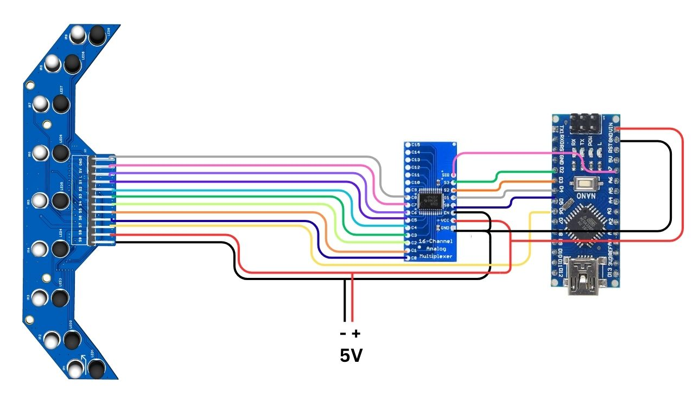

# Arduino Nano Connection

The Arduino Nano does not have nine independent analog inputs, so the supplied diagram uses a **16-channel analog multiplexer** (the manual recommends the **CD74HC4067**):

`9 sensor outputs → analog multiplexer → Arduino Nano analog input`

[PNG](circuit-diagram.png) | [PDF](circuit-diagram.pdf)

Sensors are read one at a time, not simultaneously, so the software may need extra handling.

## Pin mapping: TO BE CONFIRMED

The user manual lists the multiplexer pin mapping as not yet filled in, and the diagram is too small to read the Nano pin labels reliably. No pin numbers are documented here until you supply them.

| Connection | Pin |
|---|---|
| Sensor S1 to S9 | Multiplexer channels (channel assignment to be confirmed) |
| Multiplexer select lines (S0 to S3) | Nano digital pins: to be confirmed |
| Multiplexer common signal (SIG) | Nano analog pin: to be confirmed |
| Multiplexer EN | to be confirmed |
| L (emitter control) | Nano pin: to be confirmed |
| VCC / 5V, GND | 5 V, GND |

An application note for this setup is planned (see the root README link slots).
