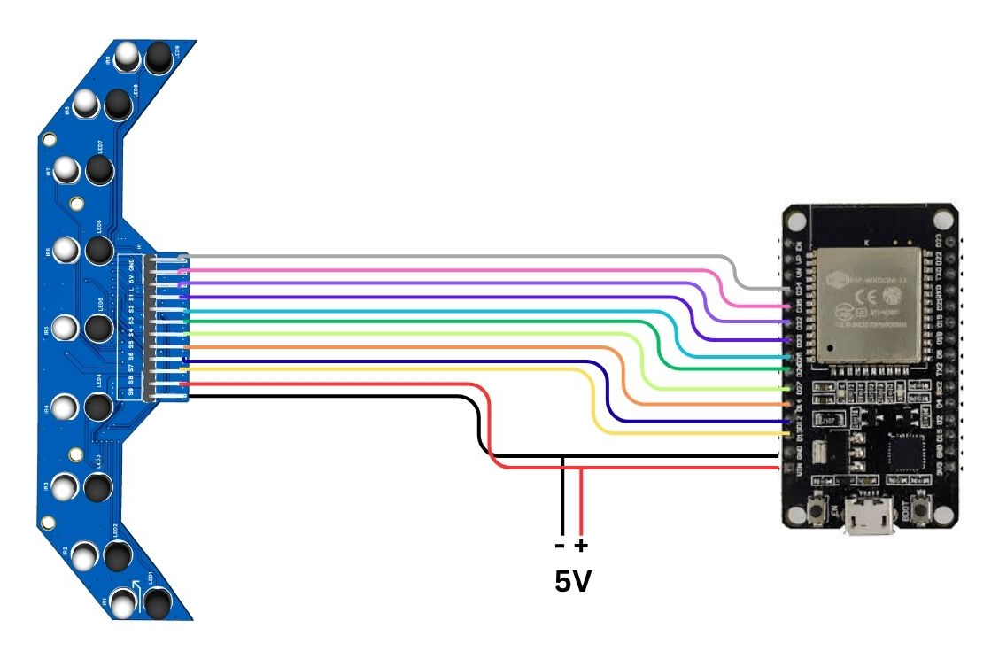

# ESP32 DevKit (classic ESP32 / ESP32-WROOM) Connection

All nine sensors connect directly to the ESP32 in the supplied diagram, with no multiplexer.

[PNG](circuit-diagram.png) | [PDF](circuit-diagram.pdf)

## Important limitation

Per the user manual, with all nine sensors on direct ADC inputs of the classic ESP32, **Wi-Fi may not be usable at the same time** (ADC2 is limited while Wi-Fi is active). The alternative is an external analog multiplexer or ADC, which adds a part and scanning software.

## Pin mapping: TO BE CONFIRMED

The user manual does **not** list a pin table for this controller. The values below were read by eye from the supplied diagram image, which is low resolution at the board header. **Do not wire from this table until you confirm it.**

| Array pin | ESP32 DevKit (read from diagram) |
|---|---|
| S1 | D34 |
| S2 | D35 |
| S3 | D32 |
| S4 | D33 |
| S5 | D25 |
| S6 | D26 |
| S7 | D27 |
| S8 | D14 |
| S9 | D12 |
| L (emitter control) | D13 |
| VCC / 5V | 5 V (VIN) |
| GND | GND |

## Status: items to confirm

- The full pin table above (confirm against your tested firmware)
- GPIO 12 is a boot strapping pin on the classic ESP32; confirm it behaves correctly at boot
- Sensor output voltage range versus the ESP32's 3.3 V ADC input limit
- Exact DevKit board model
