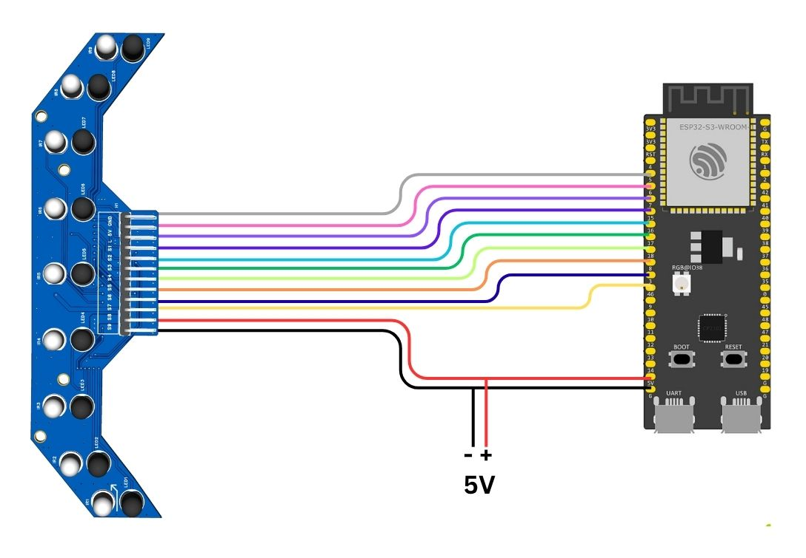

# ESP32-S3 Connection

**Recommended controller.** The ESP32-S3 can read all nine sensor outputs on ADC1 channels while Wi-Fi stays active (per the user manual).

[PNG](circuit-diagram.png) | [PDF](circuit-diagram.pdf)

## Pin mapping

Source: "Example Connection – ESP32-S3" in the user manual; the diagram uses the same wire order.

| Array pin | ESP32-S3 |
|---|---|
| S1 | GPIO 4 |
| S2 | GPIO 5 |
| S3 | GPIO 6 |
| S4 | GPIO 7 |
| S5 | GPIO 15 |
| S6 | GPIO 16 |
| S7 | GPIO 17 |
| S8 | GPIO 18 |
| S9 | GPIO 8 |
| L (emitter control) | GPIO 46 |
| VCC / 5V | 5 V |
| GND | GND |

## Status: items to confirm

- Exact ESP32-S3 board / module model the pin map was tested on
- Sensor output voltage range versus the ESP32-S3's 3.3 V ADC input limit
- Whether GPIO 46 (a strapping pin on ESP32-S3) is acceptable for `L` on your board
