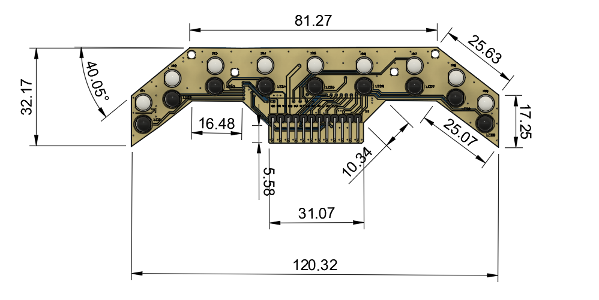
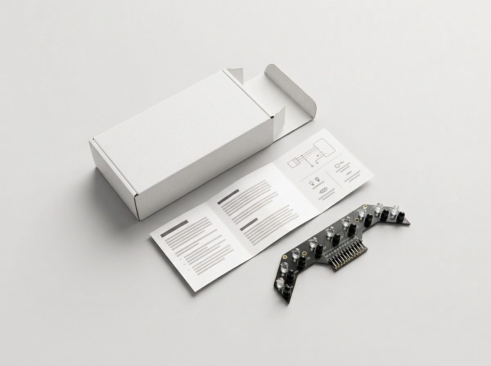
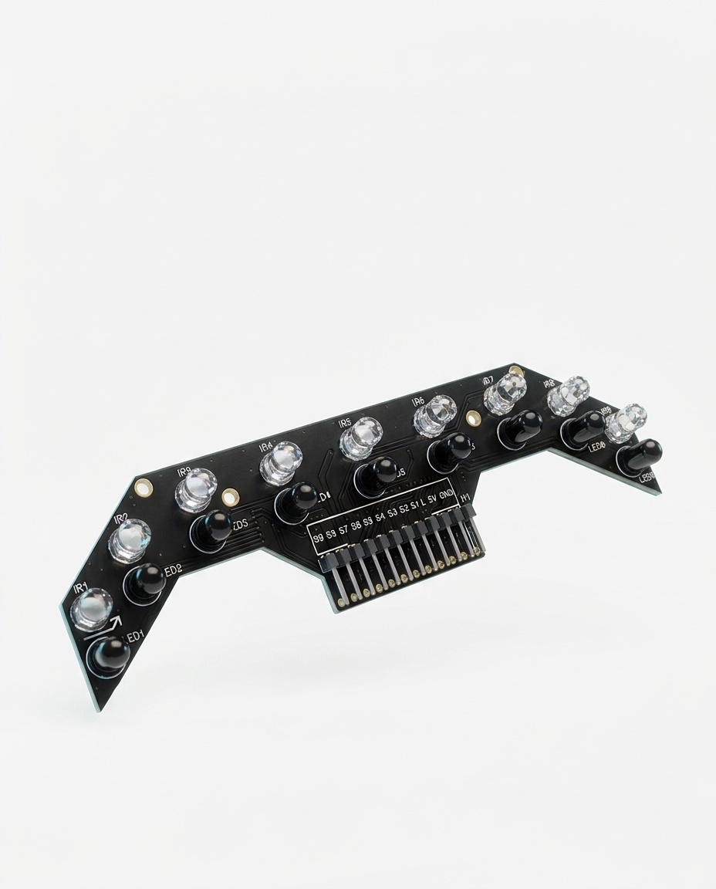
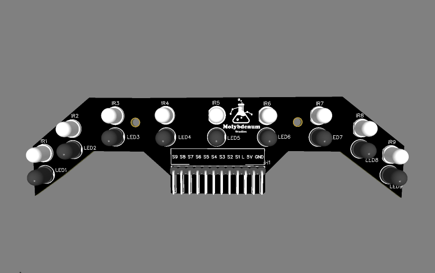
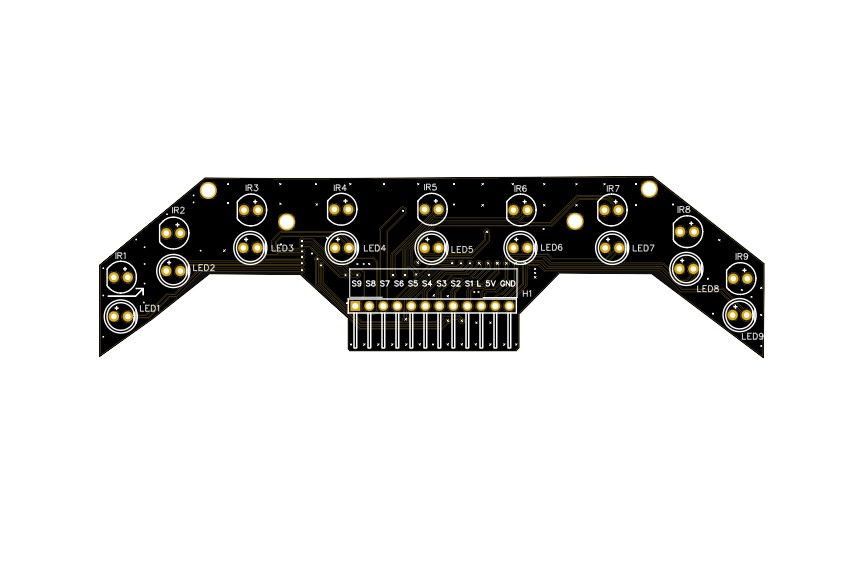
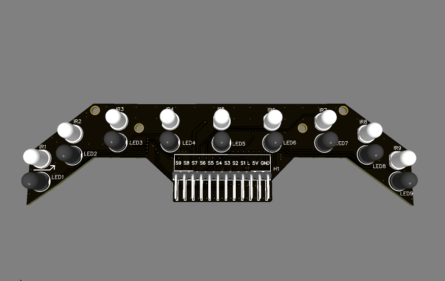
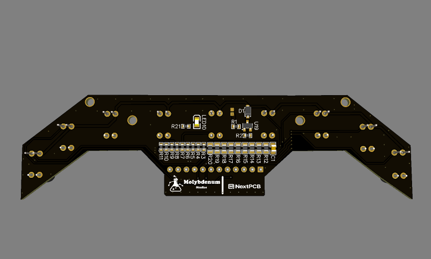
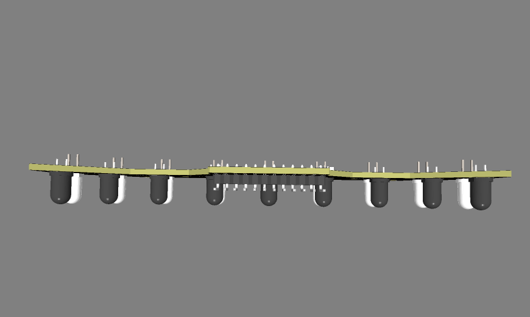

<div align="center">

# Molybdenum Studios
## 9-Sensor Line Follower Array

**A nine-channel infrared reflective sensor array for line-following robots.**

[](https://moly-dashboard.vercel.app/admin/profiles)

<!-- BUY BUTTON: to change the destination, replace the URL inside the (...) above. -->


</div>

---

## Table of Contents

1. [Product Gallery](#product-gallery)
2. [Where to Buy](#where-to-buy)
3. [Resources and Links](#resources-and-links)
4. [Product Overview](#product-overview)
5. [Key Features](#key-features)
6. [Supported Controllers](#supported-controllers)
7. [Getting Started](#getting-started)
8. [Repository Contents](#repository-contents)
9. [Applications](#applications)
10. [Contributing](#contributing)
11. [License](#license)
12. [Manufacturer](#manufacturer)

---

## Product Gallery

Renders and drawings are labelled as such. Add new images to `Product-Images/` and run `python scripts/generate_readme_gallery.py` to refresh this section.

<!-- GALLERY:START -->

|   |   |
|---|---|
| <br><sub>Mechanical drawing with dimensions (mm)</sub> | <br><sub>Product image: array with packaging and leaflet</sub> |
| <br><sub>Product image: 9-sensor array, angled view</sub> | <br><sub>3D render: front side</sub> |
| <br><sub>3D render: alternate view</sub> | <br><sub>3D render: front side, alternate angle</sub> |
| <br><sub>3D render: rear side</sub> | <br><sub>3D render: side profile</sub> |

<!-- GALLERY:END -->

---

## Where to Buy

<div align="center">

[](https://moly-dashboard.vercel.app/admin/profiles)

</div>

<!-- BUY LINK SLOT: replace the URL above with your final store / product page when it is ready. -->

---

## Resources and Links

Rows marked **Link coming soon** are placeholders. To fill one in, replace the text with a Markdown link, for example `[Datasheet (PDF)](Datasheet/9-Sensor-Array-Datasheet.pdf)`.

| Resource | Link |
|---|---|
| User manual (PDF) | [Manual/User-Manual.pdf](Manual/User-Manual.pdf) |
| User manual (Word) | _Link coming soon_ <!-- ADD LINK: Manual/User-Manual.docx --> |
| Datasheet (PDF) | _Link coming soon_ <!-- ADD LINK: Datasheet/9-Sensor-Array-Datasheet.pdf --> |
| Datasheet (Word) | _Link coming soon_ <!-- ADD LINK: Datasheet/9-Sensor-Array-Datasheet.docx --> |
| Arduino Nano + multiplexer application note | _Link coming soon_ <!-- ADD LINK --> |
| Companion app (download / QR code) | _Link coming soon_ <!-- ADD LINK --> |
| Example code / firmware | _Link coming soon_ <!-- ADD LINK --> |
| Website | _Link coming soon_ <!-- ADD LINK --> |
| Support / contact | _Link coming soon_ <!-- ADD LINK --> |
| Social media | _Link coming soon_ <!-- ADD LINK --> |

---

## Product Overview

The 9-Sensor Line Follower Array is a sensor board that tells a robot where a line is on the ground. Each of its nine channels pairs one infrared **emitter** (the clear/white component) with one infrared **receiver** (the black component). The emitter shines infrared light down at the surface and the receiver measures how much comes back. Light surfaces generally reflect more and dark lines generally reflect less, so each channel gives your controller an analog reading of what is underneath it. Which way the reading moves (white high or white low) depends on the receiver circuit and your software, so always calibrate the actual board.

**Why nine positions?** With several sensors side by side, the robot can see not only *whether* it is on the line but *how far off-centre* it is. More positions across the width means finer position estimates and a better chance of still seeing the line during sharp turns, which helps smooth steering such as PID control.

**Sensor spacing.** Neighbouring sensors are spaced approximately **15 mm** apart (centre to centre), and the board is about 120 mm long, so it covers a wider strip of track than typical 5-sensor modules.

**Emitter control (`L` pin).** The `L` input switches the infrared emitters through an **AO3400A** MOSFET, so the controller can turn the emitters on and off, for example to compare readings with and without emitters while testing.

**Optional bypass jumper.** A small solder jumper lets you keep the emitters permanently powered if you do not want software control. Follow the user manual and only bridge the designated pads.

> **Note:** The supplied manual describes `L` as ON/OFF switching and does not claim analog brightness control. That claim should be added only after the final circuit is verified.

---

## Key Features

- 9 infrared reflective sensing channels (S1 to S9), each with a separate emitter and receiver
- Approximately 15 mm sensor-to-sensor spacing
- 9 analog sensor outputs
- Emitter control input `L` using an AO3400A MOSFET
- Optional solder bypass to keep the emitters always on
- 5 V operating voltage (per user manual)
- Operating temperature listed in the manual as -10 °C to 80 °C
- Board approximately 120.32 mm × 32.17 mm (see the mechanical drawing in the gallery)
- Documented for ESP32-S3 (recommended), classic ESP32 DevKit, and Arduino Nano (with an external analog multiplexer)

Items still requiring confirmation (supply current, sensor output voltage range, sensing height) are listed in the manual and datasheet placeholders rather than guessed here.

---

## Supported Controllers

| Controller | Circuit diagram | Documentation |
|---|---|---|
| ESP32-S3 (recommended) | [Diagram](Circuits/ESP32-S3/circuit-diagram.png) | [Wiring notes](Circuits/ESP32-S3/README.md) |
| ESP32 DevKit | [Diagram](Circuits/ESP32-DevKit/circuit-diagram.png) | [Wiring notes](Circuits/ESP32-DevKit/README.md) |
| Arduino Nano (+ analog multiplexer) | [Diagram](Circuits/Arduino-Nano/circuit-diagram.png) | [Wiring notes](Circuits/Arduino-Nano/README.md) |

Each controller has its own folder because analog inputs, voltage levels and usable GPIOs differ. Do not copy wiring between them.

---

## Getting Started

1. **Select your controller.** The ESP32-S3 can read all nine sensors directly on ADC1. The classic ESP32 and Arduino Nano have limitations described in their folders.
2. **Open the matching wiring diagram** from the table above.
3. **Connect the array** using the pin table in that folder's README. Only pin assignments marked as supplied are documented; anything marked *to be confirmed* must be checked before wiring.
4. **Power the array** only within the limits in the user manual (5 V operating voltage) and confirm polarity first.
5. **Test the outputs.** Read all nine analog values with the emitters on (via `L` or the bypass jumper) over a white surface and a dark line.
6. **Calibrate and integrate.** Follow the calibration procedure and the robot-integration guidance in the [user manual](Manual/User-Manual.pdf), then mount the array at a height you have tested.

---

## Repository Contents

| Folder / file | Contents |
|---|---|
| `Product-Images/` | Product images, 3D renders and the mechanical drawing |
| `Circuits/` | One sub-folder per controller with its diagram (PNG and PDF) and wiring notes |
| `Manual/` | User manual |
| `Datasheet/` | Datasheet (to be added) |
| `scripts/` | `generate_readme_gallery.py` (refresh the gallery) and `check_repo.py` (check files and links) |

Run the checks with:

```bash
python scripts/check_repo.py
```

---

## Applications

- Line-following robots
- Robotics competitions
- Educational robotics projects
- Embedded systems experimentation
- Autonomous mobile robots
- Maze-solving robots and edge / track detection

---

## Contributing

Corrections and improvements to the documentation are welcome. Please open an issue describing the problem, or a pull request with your change. For hardware facts (pinouts, ratings), include the source so it can be verified.

---

## License

**License: to be selected by the repository owner.** No open-source license has been chosen yet. See [LICENSE](LICENSE) for how to complete this.

---

## Manufacturer

**Molybdenum Studios**

Product documentation and hardware design repository.
